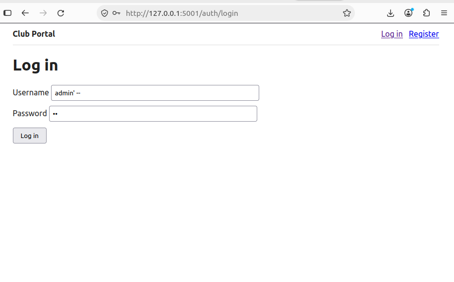
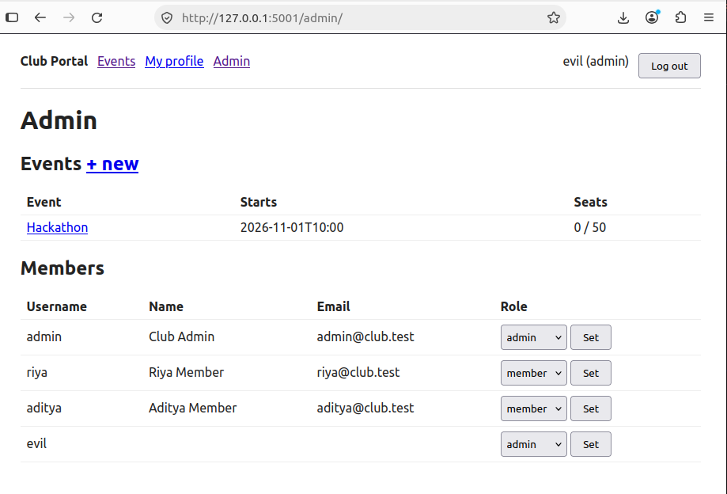
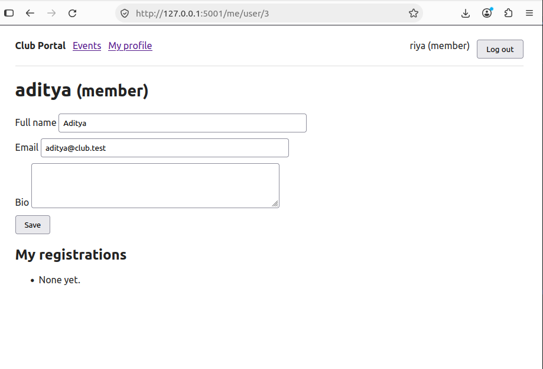
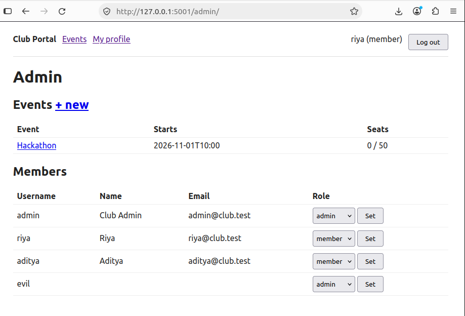
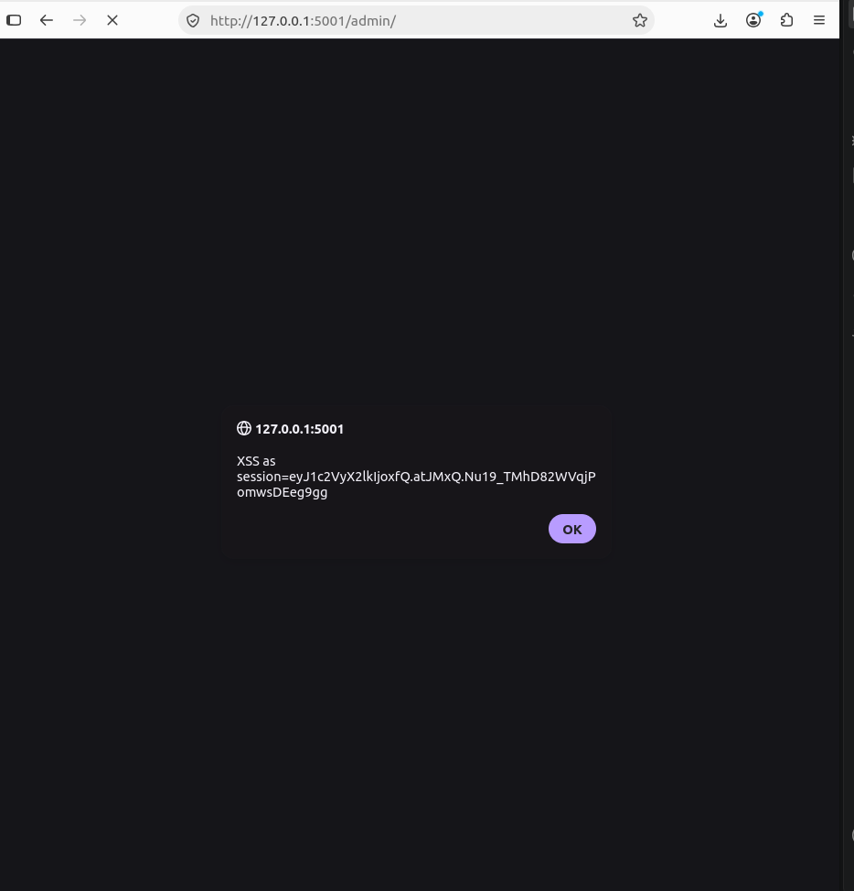

# Security Assessment Report — Club Portal

**Task:** Trust Issues (CC-VIT recruitment task).
**Author:** Mohd Arham.
**Target:** Club Portal, a Flask + SQLite web app I built (member/admin roles,
profiles, event registration, admin area).
**Scope:** My own local instance only. I built two versions: an intentionally
vulnerable one (`vulnerable` branch) and a hardened one (`main`).
**Date:** 2026-10-16.

## Summary

I built the portal twice on purpose. First I wrote a version with five real
vulnerabilities and some supporting weaknesses, so I could attack it and understand
why each one works. Then I fixed every one of them on `main` and wrote tests that
replay the attacks to prove the fixes hold.

The worst flaw was a SQL injection that let me log in as the administrator with no
password. Four of the five were broken access control or injection, which match the
top of the OWASP Top 10.

- I proved every attack against the vulnerable build. `exploits/poc.py` reports all
  five as `EXPLOITABLE` (`screenshots/06-poc-run.png`).
- On `main` the same attacks fail. The test suite passes 19 tests, 5 of which replay
  these exact attacks and assert each is now blocked (`screenshots/07-tests-pass.png`).
- A static scan (Bandit) is clean on `main` and flags the injection and the
  hard-coded secret on the vulnerable build (`screenshots/08-bandit.png`).

## How I tested

- I reviewed every route and template by hand.
- I attacked a running local instance over HTTP with a browser, `curl`, and
  `exploits/poc.py`.
- I regression-tested the fixes with `pytest`.
- I ran Bandit for static analysis and `pip-audit` for a dependency CVE check.

I tested nothing outside my own machine.

## Findings at a glance

I rate severity qualitatively: Critical = full authentication or authorization
bypass, High = privilege escalation or access to other users' data, Medium =
needs user interaction or chaining.

| ID | Finding | OWASP | Severity |
|----|---------|-------|----------|
| V1 | SQL injection — login bypass | A03 Injection | Critical |
| V2 | Mass assignment — self-promotion to admin | A01 Broken Access Control | High |
| V3 | IDOR — read/overwrite any profile | A01 Broken Access Control | High |
| V4 | Missing authorization on admin routes | A01 Broken Access Control | High |
| V5 | Stored XSS — member script runs as admin | A03 Injection | High |
| W1 | Passwords stored in plaintext | A02 Cryptographic Failures | High |
| W2 | Hard-coded `SECRET_KEY` (forgeable sessions) | A02 / A05 | High |
| W3 | No CSRF protection | A01 | Medium |
| W4 | Insecure cookie flags, no security headers | A05 Misconfiguration | Medium |

All nine are fixed on `main`.

---

## V1 — SQL injection (login bypass)

**What it is.** The login query mixes my SQL and the user's input into one string,
so input can change what the query means instead of staying data.

**How I built it.** In the vulnerable `auth.py` I formatted the username and
password straight into the SQL text (and stored passwords in plaintext so the demo
is clean):

```python
query = ("SELECT * FROM users WHERE username = '%s' AND password_hash = '%s'"
         % (username, password))
user = get_db().execute(query).fetchone()
```

**How I exploited it.** On the login form I entered the username `admin' --` and any
password (`screenshots/01-sqli-login.png`). The database runs:

```sql
SELECT * FROM users WHERE username = 'admin' --' AND password_hash = 'x'
```

`--` comments out the password check, so I log in as admin with no password
(`screenshots/01b-sqli-logged-in.png`). `' OR '1'='1' --` logs in as the first user.



**What it causes.** A complete authentication bypass. Anyone can log in as any user,
including admin, and a crafted query could read or change other data too. This is
one of the highest-severity web flaws, so I rated it Critical.

**How I fixed it.** On `main` I use a parameterised query and verify the password
with a hash check in Python:

```python
user = db.execute("SELECT id, password_hash FROM users WHERE username = ?",
                  (username,)).fetchone()
valid = check_password_hash(user["password_hash"] if user else _DUMMY_HASH, password)
```

**Why it can't happen on `main`.** The `?` placeholder sends the value to the driver
separately from the SQL text, so input is always data and can never become code. The
`admin' --` payload is just looked up as a literal username, finds nothing, and the
login is rejected.

## V2 — Mass assignment (self-promotion to admin)

**What it is.** The server copies a client-supplied field into the record even
though that field decides authorization.

**How I built it.** The vulnerable `register` reads `role` from the form, though no
such field is on the page:

```python
role = request.form.get("role", "member")
db.execute("INSERT INTO users (username, password_hash, role) VALUES (?, ?, ?)",
           (username, password, role))
```

**How I exploited it.** I registered with `curl` and added `role=admin`
(`screenshots/02a-register-curl.png`), logged in as that account
(`screenshots/02b-login-as-evil.png`), and opened the admin dashboard as a full
admin (`screenshots/02-mass-assignment.png`).



**What it causes.** Anyone can make themselves an administrator at sign-up, which
gives them every admin capability.

**How I fixed it.** On `main`, `register` never reads `role`. Every self-registered
account is a `member`, and the only way to create an admin is the `create-admin` CLI
command or an existing admin.

**Why it can't happen on `main`.** The role is never taken from the request, so a
`role=admin` field in the form is ignored. A regression test registers with
`role=admin` and asserts the account comes out as `member`.

## V3 — Insecure Direct Object Reference (IDOR)

**What it is.** A record is addressed by an id in the URL, and the app checks only
that you are logged in, not that the record is yours.

**How I built it.** The vulnerable profile route takes the id from the URL and reads
or updates whatever row it names:

```python
@bp.route("/user/<int:user_id>", methods=("GET", "POST"))
@login_required
def view_user(user_id):
    ...  # SELECT / UPDATE ... WHERE id = user_id   (id comes from the URL)
```

**How I exploited it.** Logged in as `riya`, I changed the id in the URL from my own
(`/me/user/2`) to `/me/user/3` and saw `aditya`'s name and email
(`screenshots/03-idor.png`). A POST to the same URL overwrites that person's record.



**What it causes.** I can read and tamper with any user's data by counting ids up: a
privacy breach and a data-integrity problem.

**How I fixed it.** On `main` the profile endpoint is `/me/` and it takes the id from
the session (`g.user["id"]`), so there is no id in the URL to change and no
per-id route exists.

**Why it can't happen on `main`.** The server decides whose record this is from the
logged-in session, not from anything the client sends. A request for `/me/user/3`
returns 404, and an edit only ever writes my own row.

## V4 — Broken access control on admin routes

**What it is.** The admin pages enforce "are you logged in" but not "are you an
admin," and the only thing hiding them from members is the navigation menu.

**How I built it.** The vulnerable admin views use `@login_required` and never check
the role; the template just hides the Admin link from members:

```python
@bp.route("/")
@login_required          # logged in...
def dashboard():         # ...but no check that g.user['role'] == 'admin'
    ...
```

**How I exploited it.** As `riya` (a plain member) the menu shows no Admin link
(`screenshots/04b-no-admin-link.png`), but typing `/admin/` loads the full dashboard
with every member's email (`screenshots/04-broken-access.png`). The role control has
no check either, so I promoted myself to admin (`screenshots/04a-self-promote.png`).
The same missing check lets me set the real admin to `member` and lock them out.



**What it causes.** Any member reads all members' PII, grants themselves (or anyone)
admin, and can demote the real admin. So the damage is escalation and loss of
integrity and availability, not just data exposure.

**How I fixed it.** On `main` every admin view uses a `role_required("admin")`
decorator that returns 403 unless the role stored in the database is `admin`.
`set_role` also refuses to change the acting admin's own role, which keeps at least
one admin in place.

**Why it can't happen on `main`.** A member requesting `/admin/` or the role
endpoint gets 403 — the check is on the server, not in the menu. Hiding the link was
never the control; the decorator is.

## V5 — Stored (persistent) XSS

**What it is.** User-supplied text is written into a page as live HTML, so a script
in that text runs in another person's browser.

**How I built it.** The vulnerable templates render profile fields with Jinja's
`| safe` filter, which turns escaping off:

```jinja
<td>{{ u['full_name'] | safe }}</td>
```

**How I exploited it.** As `aditya` I set my full name to a script payload
(`screenshots/05a-plant-payload.png`). When the admin opens the dashboard, the name
renders as live HTML — it shows as bold `pwned` (`screenshots/05b-rendered-name.png`)
and the script runs in the admin's browser. My alert prints the admin's own session
cookie (`screenshots/05-stored-xss.png`), which a real payload would send to an
attacker.



**What it causes.** Script runs in the victim's session. Because the attacker is a
low-privilege member and the victim is the admin, it crosses a trust boundary:
session/cookie theft, actions performed as the admin, defacement.

**How I fixed it.** On `main` I removed `| safe`, so Jinja auto-escapes every value
(`<script>` becomes inert text), and I added a Content-Security-Policy
(`default-src 'self'`, no inline script).

**Why it can't happen on `main`.** Auto-escaping turns the payload into visible text
instead of markup, and even if I ever missed an escape, the CSP blocks inline script
from running. A regression test stores the payload and asserts it comes back escaped.

---

## Supporting weaknesses

Alongside the five demonstrated flaws, the vulnerable build had four weaknesses I
also fixed on `main`:

- **W1 Plaintext passwords.** The vulnerable build stored passwords as-is. On `main`
  I hash them with scrypt (`generate_password_hash`), so a stolen database doesn't
  hand over passwords.
- **W2 Hard-coded `SECRET_KEY`.** The vulnerable build ships `SECRET_KEY="dev"`, so
  anyone who reads the source can forge a session cookie for any user. On `main` the
  key comes from the environment, with a random per-process fallback for dev.
- **W3 No CSRF protection.** The vulnerable build never checks a CSRF token. On
  `main` every state-changing POST carries a per-session token I verify with a
  constant-time compare.
- **W4 Insecure cookies and no headers.** The vulnerable build serves cookies
  without `HttpOnly`/`SameSite` and sets no security headers. On `main` the session
  cookie is `HttpOnly` and `SameSite=Lax` (and `Secure` behind HTTPS), and I set a
  Content-Security-Policy, `X-Frame-Options: DENY`, `X-Content-Type-Options`, and
  `Referrer-Policy`.

## Evidence (tooling)

| What it shows | File |
|---------------|------|
| All five attacks report `EXPLOITABLE` | [`06-poc-run.png`](../screenshots/06-poc-run.png) |
| `pytest` on `main`: 19 passed, attacks blocked | [`07-tests-pass.png`](../screenshots/07-tests-pass.png) |
| Bandit clean on `main`, flagging the vulnerable build | [`08-bandit.png`](../screenshots/08-bandit.png) |
| The vulnerable Bandit run in full (SQLi + hard-coded secret) | [`08b-bandit-detail.png`](../screenshots/08b-bandit-detail.png) |

I enforce the fixes with:

- `tests/test_security_regression.py` — replays V1–V5 and asserts each is blocked.
- `tests/test_bruteforce.py` — covers the account lockout and per-IP rate limit I added.
- `.github/workflows/ci.yml` — runs the tests, Bandit, and `pip-audit` on every push.

## Residual risk

I consider `main` safe for a small, locally hosted club portal, not an internet
deployment without more work. The gaps I'm aware of:

- Brute-force protection is single-node, so an attacker rotating IP addresses can
  still spray slowly below the per-account threshold.
- Sessions are stateless and can't be revoked before they expire.
- No MFA, and no audit log of admin actions.

## Recommendation

Deploy only the `main` build, behind HTTPS with `PORTAL_HTTPS=1` and a random
`PORTAL_SECRET_KEY`, and keep the CI pipeline required on the branch so any change
that re-opens a finding fails before it merges.
